 

---

## 👨‍💻 About Me

I'm **Igor Dias**, a programming student focused on front-end development and building digital experiences.

I enjoy turning ideas into functional projects, exploring new technologies and understanding how things work behind the code.

- 💻 Focused on Front-end Development.
- 🚀 Building personal projects and experimenting with new ideas.
- 📚 Constantly learning and improving my skills.
- 🎯 Interested in clean code, UI/UX and responsive interfaces.

---

## 🛠️ Technologies & Tools

---

## 🚀 Featured Projects

  
  
  

---

## 📊 GitHub Analytics

  
  

---

## 🔥 Contribution Streak

---

## 📊 Contribution Activity

<!-- BEGIN ACTIVITY-GRAPH -->
<picture>
  <source media="(max-width: 767px)" srcset="activity-graph-mobile.svg">
  
</picture>
<!-- END ACTIVITY-GRAPH -->

---

## 🏆 GitHub Trophies

  

---

## 🐍 Contribution Snake

<picture>
<source media="(prefers-color-scheme: dark)" srcset="https://raw.githubusercontent.com/Igor-Dias-2010/Igor-Dias-2010/output/github-snake-dark.svg">
<source media="(prefers-color-scheme: light)" srcset="https://raw.githubusercontent.com/Igor-Dias-2010/Igor-Dias-2010/output/github-snake.svg">

</picture>

---

## 🌐 Connect With Me

---

